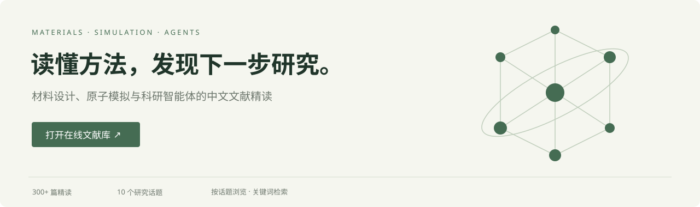

# AI for Materials 文献精读

**读懂方法，发现下一步研究。**

### [打开在线文献库 ↗](https://q734738781.github.io/materials-reading/)

面对一篇新论文，我们更想知道：**它解决了什么问题？方法到底怎样运行？带来了什么新能力，又有哪些思路值得借鉴？**

这里收集材料设计、原子模拟与科研智能体方向的中文精读。沿着研究问题、具体方法和关键发现展开，结合论文图表与公式，把从输入到验证的过程讲清楚。

## 在这里读什么

| 材料研究 | 计算与智能体方法 |
| --- | --- |
| 材料生成与逆向设计 | 电子结构学习 |
| 合成与工艺 | 机器学习势训练与泛化 |
| 自主实验闭环 | 采样与高性能原子模拟 |
| 性质、表征与材料表示 | 智能体技术与科研系统 |
| 非平衡态化学与微化工 | 跨尺度催化 |

**300余篇精读，按话题和日期浏览，也可以直接搜索模型、方法或你关心的问题。** 每篇都有独立链接，适合随手阅读、分享和后续查阅。

## 先读这几篇

- [**SO3LR Tauri：广泛量子化学数据怎样接成通用反应力场**](https://q734738781.github.io/materials-reading/notes/20261106-1003be63.html)  
  从多源训练、显式长程物理，到跨化学体系的实际模拟。
- [**无序纳米多孔碳：先规定孔，再长出碳骨架**](https://q734738781.github.io/materials-reading/notes/20261106-d9602267.html)  
  把孔径分布变成设计输入，探索无序材料的逆向设计。
- [**WASP-Mem：让智能体整理经验，把人工用在失败诊断**](https://q734738781.github.io/materials-reading/notes/20261106-320db77b.html)  
  看操作经验如何积累，以及怎样的反馈能帮助下一次任务。

---

### [进入文献库，找到下一篇值得读的论文 →](https://q734738781.github.io/materials-reading/)

[站点维护说明](docs/MAINTENANCE.md)
